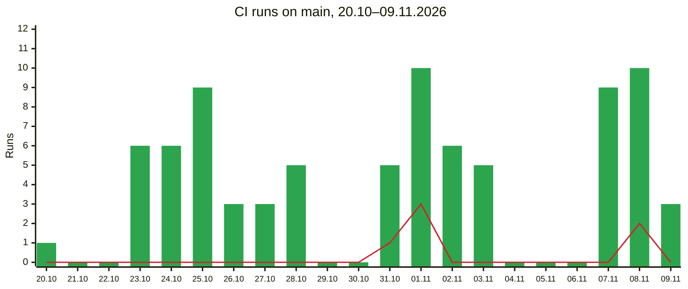

# DORA Summary

DORA metrics of the `CI` workflow on `main` for the runs created from 20.10 to 09.11.2026 (UTC, 3 weeks). These are rows №117–№210 of [`metrics-raw.md`](metrics-raw.md), which holds the full history from 12.09 to 11.11. The per-PR lead times and the recovery incidents of the period are in [`evidence/dora-metrics-2026-10-20-to-2026-11-09.json`](evidence/dora-metrics-2026-10-20-to-2026-11-09.json).

## DORA Metrics

| Metric | Formula | Result | Category |
|---|---|---|---|
| Deployment frequency | green `main` runs ÷ weeks: 81 ÷ 3 | 27 per week | Hourly to daily → 22.7% |
| Change lead time | from the first commit of a PR to the completion of the first green `main` run that contains it; mean and median of 89 PRs | mean 30 h 10 min, median 5 h 23 min | Under a day → 24.4% |
| Change fail rate | red `main` runs ÷ completed `main` runs × 100%: 6 ÷ 87; the 7 cancelled runs count as neither | 6.9% | 4–8% → 36.2% |
| Failed deployment recovery time | from a red `main` run to the next green one; mean and median of 4 incidents | mean 4 h 10 min, median 1 h 11 min | Under a day → 56.5% |

### Queue and Execution in the Lead Time

Each PR's lead time is split into the time before its green `main` run started, the run's queue and its execution (`shares_percent` and `change_lead_time.items` in the [evidence](evidence/dora-metrics-2026-10-20-to-2026-11-09.json)).

| Part | Share of the lead time | Per PR: mean | Per PR: median |
|---|---|---|---|
| Before the run: the PR is open, waits for review or for the merge | 99.74% | 30 h 5 min | 5 h 20 min |
| Queue | 0.08% | 1.5 min | 0.1 min |
| Execution | 0.18% | 3.3 min | 2.7 min |

Of the time a change spends in CI, 31.5% is the queue. The mean is pulled up by a few long waits, up to 23.6 min; the median is 0.1 min.

## Paired Analysis

**Speed.** 27 deployments a week and a median lead time of 5 h 23 min look fast, but the mean is 30 h 10 min: 21 of 89 PRs took more than a day, 4 of them more than a week (the longest, #362, 8 d 23 h). The pipeline is not what holds them: 99.74% of the lead time passes before the green run starts.

**Stability.** 6 of 87 runs were red (6.9%), and the median return to green was 1 h 11 min. None of the six was a defect in the product code that passed the PR checks: four came from setting up the staging image publish (№157, №159–№161), one was a hung reliability test (№202) and one a flaky e2e test (№207).

**Together.** Frequent merges did not cost stability: `main` turned red on pipeline changes and on tests, not on the features merged. Speed and stability follow the same rhythm. 49 of 81 deployments were on a Saturday or a Sunday, 7 of 21 days had none, and all six red runs fell on the busy weekends of 31.10–01.11 and 08.11. The longest recovery, 14 h 14 min after №207, started on Sunday afternoon and ended on Monday morning. So the lead time is set before the merge, and the recovery time by how soon someone notices a red `main`.

### Runs per Day

Green runs on `main` (bars) and red runs (line) by the UTC day the run was created:



## CI Benchmarks

| Indicator | Recommended | CircleCI 2025 data | Ours |
|---|---|---|---|
| Success rate on `main` | 90% | 70.8% | 81 / 87 = **93.1%** |
| Return of `main` to green | under 60 min | 59.2 min (median) | **70.5 min** (median) |
| Workflow duration | under 10 min | 2.2 min (median) | **2.7 min** (median); 3.0 min with the queue |

## Improvement Backlog

| Metric | Problem | Root cause | Action | Owner |
|---|---|---|---|---|
| Change lead time | 21 of 89 PRs over a day, up to 9 days | Large PRs (up to 100 commits) | Split features into PRs of at most a day's work | @viktoriyabaran |
| Change lead time | 98.9% of lead time is before the merge | PRs wait for review | Review within one working day | @DarynaHalytska |
| Deployment frequency | No deployment on 7 of 21 days | Work done in bursts around lab deadlines | Merge small PRs daily | @viktoriyabaran |
| Deployment frequency | 25 of 88 PRs changed the committed coverage reports; 9 merges of `main` into a branch had to redo them | Generated reports conflict between PRs | Stop committing coverage reports; publish them from CI | @OLEGkn-coder |
| Change fail rate | Flaky rate limit test (№207) | Not yet known | Flaky test hunt: 5 runs of the suite on one commit; quarantine with an issue | @viktoriyabaran |
| Change fail rate | Reliability tests hung until the timeout (№202) | A started process is left open | Stop the started APIs in `after`; `--test-force-exit` | @OLEGkn-coder |
| Recovery time | Red `main` for 14 h (№207) | Nobody watches `main` | Notify the team chat when `main` turns red | @Vlad-Re |

## Bonuses

### 1. Automatic metrics

[`scripts/ci-metrics/collect.mjs`](../../scripts/ci-metrics/collect.mjs) takes the runs of `CI` on `main` from the GitHub Actions REST API and computes the four metrics by the lab's Working Definitions for a given period, with the queue and the execution of each run apart. It runs by hand only; there is no workflow. The result for the full history is [`evidence/dora-metrics.json`](evidence/dora-metrics.json), the result for 20.10–09.11 is [`evidence/dora-metrics-2026-10-20-to-2026-11-09.json`](evidence/dora-metrics-2026-10-20-to-2026-11-09.json). The commands below reproduce the second one from the committed [`runs.json`](evidence/runs.json): the first copies it into a scratch folder, the second computes the metrics of the period into `dora-metrics.json` there. The options are in the script's [README](../../scripts/ci-metrics/README.md).

```bash
mkdir -p ci-metrics-out/period && cp docs/ci-cd/evidence/runs.json ci-metrics-out/period/
node scripts/ci-metrics/collect.mjs --metrics --out ci-metrics-out/period --notes docs/ci-cd/evidence/notes.json --from 2026-10-20 --to 2026-11-09
```

| Metric, 20.10–09.11 | By hand (Stage 2) | Script |
|---|---|---|
| Deployment frequency | 27 per week | 81 deployments in 21 days = 27 per week |
| Change lead time | mean 30 h 10 min, median 5 h 23 min | mean 30 h 10 min, median 5 h 23 min (89 changes) |
| Change fail rate | 6.9% (6 of 87) | 6.9% (6 of 87) |
| Failed deployment recovery time | mean 4 h 10 min, median 1 h 11 min | mean 4 h 10 min, median 1 h 11 min (4 incidents) |

The numbers match under the two readings the hand count used: an incident is the series of red runs up to the next green one, and the lead time is counted per PR and ends with the first green run after the merge. The 98.9% share of the lead time before the merge in the Improvement Backlog the script does not reproduce: it gets 99.7%.

## Bonuses

### 2. Fast and slow test suites

In our CI, the lab's fast suite is the unit tests in the `CI passed` job, and its slow suite is the e2e tests in the `E2E tests` job.

The tests of the `CI` workflow ([`ci.yml`](../../.github/workflows/ci.yml)) are split between these two jobs, so the duration of each shows on the run page:

- **Unit tests**, in the `CI passed` job: `npm run test:unit`, next to lint, formatting, type checks, the spec check and the audit. No database. Runs on every pull request and push.
- **E2E tests**, in the new `E2E tests` job: they are slow because they need the database, so the job starts a PostgreSQL 18 service, applies the Prisma migrations and then runs all tests with the coverage gate (`npm run test:coverage`: unit and e2e, 90% of lines, 80% of branches). Runs after a green `CI passed` on a push or a manual run on `main` or `staging`: after every merge to `main` and before every staging publish, which waits for it. Never on a pull request. No scheduled runs, to save billed Actions minutes.

`E2E tests` is not a required check, and `Deploy API docs` does not wait for it. The split is described in the [testing strategy](../testing/testing-strategy.md#unit-and-e2e-tests-in-ci).

| | Run | `CI passed` | `E2E tests` |
|---|---|---|---|
| Pull request before the split | [run 43220805887](https://github.com/ukma-fin-ssdm-2026/pun-intended-team/actions/runs/43220805887), 12.11 | 4 min 38 s, of which 1 min 42 s is the coverage run of all tests and 12 s the start of the database | did not exist |
| Pull request after the split (unit tests only) | TODO | TODO | not run |
| `main` after the split (unit and e2e tests) | TODO | TODO | TODO |

In the five latest pull request runs before the split, `CI passed` took between 3 min 45 s and 4 min 38 s.

**Trade-off.** A broken migration, an e2e regression or a coverage drop is now caught only after the merge, when `main` already contains it. A red `E2E tests` on `main` is handled like any red `main`: the author of the merged pull request fixes it or reverts the merge before anything else is merged; TODO: confirm with the team who watches `main` for it (the backlog's "notify the team chat when `main` turns red" action, owner @Vlad-Re, would cover it).

## AI Usage Note

The metrics were computed by Claude Code from the collected run data, following the lab's definitions; the improvement backlog was drafted by Claude Code. Reviewed by the team.
