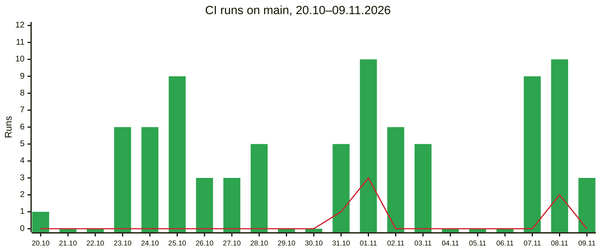

# DORA Summary

DORA metrics of the `CI` workflow on `main` for the runs created from 20.10 to 09.11.2026 (UTC, 3 weeks). These are rows №117–№210 of [`metrics-raw.md`](metrics-raw.md), which holds the full history from 12.09 to 11.11. The per-PR lead times and the recovery incidents of the period are in [`evidence/dora-metrics-2026-10-20-to-2026-11-09.json`](evidence/dora-metrics-2026-10-20-to-2026-11-09.json).

## Working Definitions

We use the lab's definition: a **deployment** is a green run of the `CI` workflow ([`ci.yml`](../../.github/workflows/ci.yml)) on `main`, and a **failure** is a red one. `CI` is the only workflow that runs on a push to `main`, so it is the only one counted. In the period, the image publication and the staging deployment were jobs of `CI` on `main` too, and a red job in any of them made the commit red (№159–№161); since then the staging jobs run only on the `staging` branch. Cancelled runs count as neither. DORA measures deployments to production; ours are green CI runs, so all four numbers are an approximation. Bonus 5 recomputes them with the image publication as the deployment.

## DORA Metrics

| Metric | Formula | Result | Category |
|---|---|---|---|
| Deployment frequency | green `main` runs ÷ weeks: 81 ÷ 3 | 27 per week | Hourly to daily → 22.7% |
| Change lead time | from the first commit of a PR to the completion of the first green `main` run that contains it; mean and median of 89 PRs | mean 30 h 10 min, median 5 h 23 min | Under a day → 24.4% |
| Change fail rate | red `main` runs ÷ completed `main` runs × 100%: 6 ÷ 87; the 7 cancelled runs count as neither | 6.9% | 4–8% → 36.2% |
| Failed deployment recovery time | from a red `main` run to the next green one; mean and median of 4 incidents | mean 4 h 10 min, median 1 h 11 min | Under a day → 56.5% |

### Queue and Execution in the Lead Time

Each PR's lead time is split into the time before its green `main` run started, the run's queue and its execution (`shares_percent` and `change_lead_time.items` in the [evidence](evidence/dora-metrics-2026-10-20-to-2026-11-09.json)).

| Part | Share of the lead time | Per PR: mean | Per PR: median |
|---|---|---|---|
| Before the run: the PR is open, waits for review or for the merge | 99.74% | 30 h 5 min | 5 h 20 min |
| Queue | 0.08% | 1.5 min | 0.1 min |
| Execution | 0.18% | 3.3 min | 2.7 min |

Of the time a change spends in CI, 31.5% is the queue. The mean is pulled up by a few long waits, up to 23.6 min; the median is 0.1 min.

## Paired Analysis

**Speed.** 27 deployments a week and a median lead time of 5 h 23 min look fast, but the mean is 30 h 10 min: 21 of 89 PRs took more than a day, 4 of them more than a week (the longest, #362, 8 d 23 h). The pipeline is not what holds them: 99.74% of the lead time passes before the green run starts.

**Stability.** 6 of 87 runs were red (6.9%), and the median return to green was 1 h 11 min. None of the six was a defect in the product code that passed the PR checks: four came from setting up the staging image publish (№157, №159–№161), one was a hung reliability test (№202) and one a flaky e2e test (№207).

**Together.** Frequent merges did not cost stability: `main` turned red on pipeline changes and on tests, not on the features merged. Speed and stability follow the same rhythm. 49 of 81 deployments were on a Saturday or a Sunday, 7 of 21 days had none, and all six red runs fell on the busy weekends of 31.10–01.11 and 08.11. The longest recovery, 14 h 14 min after №207, started on Sunday afternoon and ended on Monday morning. So the lead time is set before the merge, and the recovery time by how soon someone notices a red `main`.

### Runs per Day

Green runs on `main` (bars) and red runs (line) by the UTC day the run was created:



## CI Benchmarks

| Indicator | Recommended | CircleCI 2025 data | Ours |
|---|---|---|---|
| Success rate on `main` | 90% | 70.8% | 81 / 87 = **93.1%** |
| Return of `main` to green | under 60 min | 59.2 min (median) | **70.5 min** (median) |
| Workflow duration | under 10 min | 2.2 min (median) | **2.7 min** (median); 3.0 min with the queue |

## Root Causes

### Postmortems of the Red `main` Runs

One short blameless postmortem per incident of 20.10–09.11: what broke, why the pull request checks let it through, and which check would have caught it. The causes are in the Note column of [`metrics-raw.md`](metrics-raw.md).

| Runs | PR | What broke | Why the PR checks missed it | Check that would catch it | Back to green |
|---|---|---|---|---|---|
| №157 | #330 | `Publish API image`: GHCR refused the push (`denied`) | The job runs only on `main`, and the package's access is set in GitHub, not in the repository | A checklist in [`staging.md`](../operations/staging.md) of the settings outside the repository (package access, repository variables, environment rules), checked before a publish or deploy change is merged | 1 h 58 min: a re-run of the failed job, no code change |
| №159–№161 | #333 | The web image build: `EXPO_PUBLIC_GOOGLE_CLIENT_ID` was empty (№159); GHCR refused the web image (№160); the `staging` environment did not allow `main` to deploy (№161) | Same: three settings outside the repository, in jobs a pull request never runs | The same checklist; the build stops at once with the name of an empty build variable | 23 min: re-runs, no code change; #335 then deployed staging only from the `staging` branch |
| №202 | #411 | `Reliability tests` ran into the 10-minute job timeout | The log stops after the first test file, and `node --test` reports the files in order, so the second one, `database-timeouts.reliability.test.ts`, never ended: one of its waits has no time limit (`stopApi` waits for the API to exit, `close` of the fake database for its connections). The PR's own run was green, so it does not hang every time | A time limit per test and hook (`--test-timeout`), and `stopApi` kills the API if it does not exit in a few seconds, so a hang fails fast and names the hook | 3 min: the next merge was green |
| №207 | #414 | e2e: the per-IP rate limit tests got 401 and 400 instead of 429 | Not a port clash: the log has no `EADDRINUSE`, though an API's start-up errors do reach it (the `TRUST_PROXY=true` one is there). So the API with the limit of 2 answered the third request without 429; why is still unknown. The PR changed only `CHANGELOG.md`, and the next run was green without a code change, so the test is flaky | Five runs of the suite on one commit (flaky test hunt), and the tests assert all three statuses, so the next failure shows which requests were counted | 14 h 14 min: red from Sunday afternoon, nobody noticed until Monday morning |

None of the six red runs was a defect in the product code: four were the first runs of new pipeline jobs, two were tests.

### Technical and Organizational Root Causes

Technical:

- **Pipeline jobs that a pull request cannot run.** The publish and deploy jobs run only on `main` or `staging`, and their settings live in GitHub, set by hand. All four pipeline failures came from this (№157, №159–№161, PRs #330, #333).
- **Unreliable tests.** A reliability test file that waits without a time limit (№202) and a flaky rate limit test whose cause is not yet known (№207).
- **Runner queue before a deadline.** On the evening of 01.11 runs waited 11–73 min for a runner (№167–№172); #352 moved the jobs to GitHub-hosted runners the same evening. The queue is 31.5% of the time in CI but only 0.08% of the lead time.
- **Sequential jobs.** On `main`, `E2E tests` waited for `CI passed` (#454 changed it).

Organizational:

- **Long-lived branches.** 76% of the lead time of the 89 PRs passed between their first and last commit, 22% between the last commit and the merge. 18 of the 21 PRs that took over a day had more than 24 h between their first and last commit, e.g. #275 (8 days), #258 and #260 (7 days); #247 had 102 commits.
- **PRs waiting for review.** 6 of 89 PRs waited more than a day after their last commit; #298, one commit, waited 7 days, and #362 38 h after its last commit.
- **Work in bursts around deadlines.** 49 of 81 deployments were on a Saturday or a Sunday, and 7 of 21 days had none; all six red runs fell on the weekends of 31.10–01.11 and 08.11.
- **Nobody watches `main`.** After №207 `main` stayed red for 14 h.
- **Generated files in pull requests.** 25 of 88 PRs changed the committed coverage reports, and 9 merges of `main` into a branch had to redo them (#453 changed it).

## Improvement Backlog

| Metric | Problem | Root cause | Action | Owner |
|---|---|---|---|---|
| Change lead time | 21 of 89 PRs over a day, up to 9 days | Large PRs (up to 100 commits) | Split features into PRs of at most a day's work | @viktoriyabaran |
| Change lead time | 99.7% of lead time is before the merge | PRs wait for review | Review within one working day | @DarynaHalytska |
| Change lead time | A `main` run takes 4–6 min | `E2E tests` waits for `CI passed`, whose checks already ran on the pull request | Run `E2E tests` side by side with `CI passed` (#454, done; see Bonuses) | @OLEGkn-coder |
| Deployment frequency | No deployment on 7 of 21 days; 49 of 81 on weekends | Work done in bursts around lab deadlines | Merge small PRs daily | @viktoriyabaran |
| Deployment frequency | 25 of 88 PRs changed the committed coverage reports; 9 merges of `main` into a branch had to redo them | Generated reports conflict between PRs | Stop committing coverage reports (#453, done; see below) | @OLEGkn-coder |
| Change fail rate | 4 of 6 red runs were new publish and deploy jobs (№157, №159–№161) | Their settings are outside the repository, and a PR cannot run them | A checklist of those settings in `staging.md`, checked before the merge; the image build names an empty build variable | @viktoriyabaran |
| Change fail rate | Flaky rate limit test (№207) | Unknown; not a port clash, as the log has no `EADDRINUSE` | Flaky test hunt: 5 runs of the suite on one commit; the tests assert all three statuses; quarantine with an issue | @viktoriyabaran |
| Change fail rate | Reliability tests hung until the timeout (№202) | A wait without a time limit in `database-timeouts.reliability.test.ts` | `--test-timeout` for the reliability tests; `stopApi` kills an API that does not exit in a few seconds | @OLEGkn-coder |
| Recovery time | Red `main` for 14 h (№207) | Nobody watches `main` | Notify the team chat when `main` turns red (#455) | @Vlad-Re |
| Recovery time | Each red run waited for someone to notice it | No rule for a red `main` | A red `main` comes first: the author of the merged PR fixes or reverts it, and nothing else is merged meanwhile | @viktoriyabaran |
| Recovery time | 1 h 58 min to green after №157 | A pipeline change was first run on `main` with nobody watching | The author of a pipeline change watches its first `main` run and re-runs it once the setting is fixed | @OLEGkn-coder |

### Implemented: Stop Committing Coverage Reports

**Action** (#453): the coverage reports in `docs/testing/coverage/` are no longer committed, and `npm run docs:coverage` is gone. The coverage gate still fails `E2E tests` in CI, and `npm run test:coverage` writes a report to `coverage/index.html` locally.

**Metric:** the rework that the committed reports caused, which held back deployment frequency. Each report was one generated HTML file, so two pull requests that regenerated it conflicted: the second one waited for a merge of `main`, a new report and a new CI run before it could be merged. Once the reports are not committed, this rework is gone, so both counts after the merge are 0.

| | Pull requests that changed the reports | Merges of `main` into a branch that had to redo them |
|---|---|---|
| Before, 20.10–09.11 | 25 of 88 | 9 |
| After the merge of #453 | 0 | 0 |

## What Pain Did These Metrics Show?

1. **Changes wait for people, not for CI.** 99.7% of the lead time passes before the `main` run starts, while a run takes 2.7 min (median). 21 of 89 PRs took more than a day, 4 more than a week: large PRs wait for review.
2. **We work in bursts.** 49 of 81 deployments were on a Saturday or a Sunday, and 7 of 21 days had none.
3. **Nobody watches a red `main`.** The longest incident, after №207, lasted 14 h 14 min, from Sunday afternoon to Monday morning. We do not record when someone noticed a red run, so "noticing is the bottleneck" is a hypothesis, not a measurement.
4. **The stability numbers rest on a small sample.** There were 6 failures and 4 incidents, and the one after №207 makes up 86% of the total recovery time, so the mean of 4 h 10 min says little; the median of 1 h 11 min is closer to a typical incident.

## Bonuses

### 1. Automatic metrics

[`scripts/ci-metrics/collect.mjs`](../../scripts/ci-metrics/collect.mjs) takes the runs of `CI` on `main` from the GitHub Actions REST API and computes the four metrics by the lab's Working Definitions for a given period, with the queue and the execution of each run apart. It runs by hand only; there is no workflow. The result for the full history is [`evidence/dora-metrics.json`](evidence/dora-metrics.json), the result for 20.10–09.11 is [`evidence/dora-metrics-2026-10-20-to-2026-11-09.json`](evidence/dora-metrics-2026-10-20-to-2026-11-09.json). The commands below reproduce the second one from the committed [`runs.json`](evidence/runs.json): the first copies it into a scratch folder, the second computes the metrics of the period into `dora-metrics.json` there. The options are in the script's [README](../../scripts/ci-metrics/README.md).

```bash
mkdir -p ci-metrics-out/period && cp docs/ci-cd/evidence/runs.json ci-metrics-out/period/
node scripts/ci-metrics/collect.mjs --metrics --out ci-metrics-out/period --notes docs/ci-cd/evidence/notes.json --from 2026-10-20 --to 2026-11-09
```

| Metric, 20.10–09.11 | By hand (Stage 2) | Script |
|---|---|---|
| Deployment frequency | 27 per week | 81 deployments in 21 days = 27 per week |
| Change lead time | mean 30 h 10 min, median 5 h 23 min | mean 30 h 10 min, median 5 h 23 min (89 changes) |
| Change fail rate | 6.9% (6 of 87) | 6.9% (6 of 87) |
| Failed deployment recovery time | mean 4 h 10 min, median 1 h 11 min | mean 4 h 10 min, median 1 h 11 min (4 incidents) |

The numbers match under the two readings the hand count used: an incident is the series of red runs up to the next green one, and the lead time is counted per PR and ends with the first green run after the merge.

### 2. Improvement with a measured effect

**Action** (#454): `E2E tests` no longer waits for `CI passed`, so on `main` the two jobs run side by side ([`ci.yml`](../../.github/workflows/ci.yml)). `CI passed` already ran the same checks on the pull request, so on `main` it rarely fails; if it does, `E2E tests` still runs, and `Publish API image` still waits for both.

**Metric:** the execution part of the change lead time, as the duration of a `main` run. Before, a run was `CI passed`, then `E2E tests`, then `Publish API image`; now it is the longer of the first two, then the publish. The durations are from the run pages: a run from its creation to its last update, a job from its start to its completion; the timings are in [`evidence/bonus-2-3-run-timings.json`](evidence/bonus-2-3-run-timings.json). `Publish API image` exists since #459, so the last column leaves it out to compare runs before and after it.

Before, runs of merged pull requests that change code, tests or configuration:

| PR | Run | Total | `CI passed` | `E2E tests` | `Publish API image` | Total without the publish |
|---|---|---|---|---|---|---|
| #436 | [43469003455](https://github.com/ukma-fin-ssdm-2026/pun-intended-team/actions/runs/43469003455) | 4 min 30 s | 2 min 16 s | 2 min 9 s | — | 4 min 30 s |
| #437 | [43475971213](https://github.com/ukma-fin-ssdm-2026/pun-intended-team/actions/runs/43475971213) | 5 min 47 s | 2 min 38 s | 3 min 3 s | — | 5 min 47 s |
| #404 | [43601811569](https://github.com/ukma-fin-ssdm-2026/pun-intended-team/actions/runs/43601811569) | 4 min 34 s | 1 min 41 s | 2 min 49 s | — | 4 min 34 s |
| #459 | [43619040962](https://github.com/ukma-fin-ssdm-2026/pun-intended-team/actions/runs/43619040962) | 10 min 21 s: about 4 min more than its jobs, as it was created in the same minute as the run of #458 | 1 min 38 s | 2 min 48 s | 1 min 31 s | 8 min 50 s |
| #449 | [43627146940](https://github.com/ukma-fin-ssdm-2026/pun-intended-team/actions/runs/43627146940) | 5 min 33 s | 1 min 15 s | 2 min 27 s | 1 min 44 s | 3 min 49 s |

After, the first runs after the merge of #454 under the same rule (the runs of #471 and #475 change only documentation, the run of #472 was cancelled):

| PR | Run | Total | `CI passed` | `E2E tests` | `Publish API image` | Total without the publish |
|---|---|---|---|---|---|---|
| #473 | [43812051966](https://github.com/ukma-fin-ssdm-2026/pun-intended-team/actions/runs/43812051966) | 5 min 59 s | 1 min 19 s | 3 min 35 s | 2 min 19 s | 3 min 40 s |
| #464 | [43812204146](https://github.com/ukma-fin-ssdm-2026/pun-intended-team/actions/runs/43812204146) | 9 min 26 s: about 4 min 30 s more than its jobs, as it waited for the run of #473 to finish | 1 min 38 s | 3 min 30 s | 1 min 22 s | 8 min 4 s |
| #478 | [43945567593](https://github.com/ukma-fin-ssdm-2026/pun-intended-team/actions/runs/43945567593) | 5 min 27 s | 2 min 28 s | 3 min 28 s | 1 min 53 s | 3 min 34 s |
| #479 | [43946446210](https://github.com/ukma-fin-ssdm-2026/pun-intended-team/actions/runs/43946446210) | 4 min 51 s, of which 25 s waiting for the run of #478 | 2 min | 2 min 45 s | 1 min 37 s | 3 min 14 s |
| #481 | [43952170304](https://github.com/ukma-fin-ssdm-2026/pun-intended-team/actions/runs/43952170304) | 4 min 20 s | 2 min 29 s | 2 min 31 s | 1 min 45 s | 2 min 35 s |

Without the two runs that waited for an earlier run on `main` (#459 and #464), a run without the publish took 3 min 49 s to 5 min 47 s before, mean 4 min 40 s, and 2 min 35 s to 3 min 40 s after, mean 3 min 16 s: 1 min 24 s, or 30%, shorter; with them, the mean fell from 5 min 30 s to 4 min 13 s. `CI passed` now ends first in every run, so a run lasts as long as `E2E tests`; that job was slower after, 2 min 31 s to 3 min 35 s against 2 min 9 s to 3 min 3 s, so the run saved less than the length of `CI passed`. `Reliability tests` ran at the start of every run in both tables, so it makes no difference.

### 3. Fast and slow test suites

In our CI, the lab's fast suite is the unit tests in the `CI passed` job, and its slow suite is the e2e tests in the `E2E tests` job.

The tests of the `CI` workflow ([`ci.yml`](../../.github/workflows/ci.yml)) are split between these two jobs, so the duration of each shows on the run page:

- **Unit tests**, in the `CI passed` job: `npm run test:unit`, next to lint, formatting, type checks, the spec check and the audit. No database. Runs on every pull request and push.
- **E2E tests**, in the new `E2E tests` job: they are slow because they need the database, so the job starts a PostgreSQL 18 service, applies the Prisma migrations and then runs all tests with the coverage gate (`npm run test:coverage`: unit and e2e, 90% of lines, 80% of branches). Runs on a push or a manual run on `main` or `staging`, since #454 side by side with `CI passed`: after every merge to `main` and before every staging publish, which waits for it. Never on a pull request. No scheduled runs, to save billed Actions minutes.

`E2E tests` is not a required check, and `Deploy API docs` does not wait for it. The split is described in the [testing strategy](../testing/testing-strategy.md#unit-and-e2e-tests-in-ci).

| | Run | `CI passed` | `E2E tests` |
|---|---|---|---|
| Pull request before the split | [run 43220805887](https://github.com/ukma-fin-ssdm-2026/pun-intended-team/actions/runs/43220805887), 12.11 | 4 min 38 s, of which 1 min 42 s is the coverage run of all tests and 12 s the start of the database | did not exist |
| Pull request after the split (unit tests only) | [run 45153834852](https://github.com/ukma-fin-ssdm-2026/pun-intended-team/actions/runs/45153834852), 23.11 | 1 min 56 s, of which 24 s is the unit tests | not run |
| `main` after the split (unit and e2e tests) | [run 43945567593](https://github.com/ukma-fin-ssdm-2026/pun-intended-team/actions/runs/43945567593), 16.11 | 2 min 28 s, of which 22 s is the unit tests | 3 min 28 s, of which 2 min 8 s is the coverage run of all tests and 11 s the start of the database |

In the five latest pull request runs before the split, `CI passed` took between 3 min 45 s and 4 min 38 s. In the five latest pull request runs after the split, `CI passed` took between 1 min 21 s and 2 min 5 s; these are the runs before #496 added the app's Jest tests to it. The timings are in [`evidence/bonus-2-3-run-timings.json`](evidence/bonus-2-3-run-timings.json).

**Trade-off.** A broken migration, an e2e regression or a coverage drop is now caught only after the merge, when `main` already contains it. A red `E2E tests` on `main` is handled like any red `main`: the author of the merged pull request fixes it or reverts the merge before anything else is merged; TODO: confirm with the team who watches `main` for it (the backlog's "notify the team chat when `main` turns red" action, owner @Vlad-Re, would cover it).

### 5. Release artifact from every green `main` run

The `Publish API image` job of [`ci.yml`](../../.github/workflows/ci.yml) runs after every green run on `main`, once `CI passed`, `E2E tests` and `Reliability tests` are green. It builds the API image and pushes it to `ghcr.io/ukma-fin-ssdm-2026/nearby-api`, tagged with the full commit SHA ([package page](https://github.com/orgs/ukma-fin-ssdm-2026/packages/container/package/nearby-api)); it logs in with `GITHUB_TOKEN` and `packages: write`. The web image is left out: its build needs the staging settings. The package is private, so the same job then deletes old versions and keeps the image tagged `staging` and the 3 newest others; a cleanup in a separate job would stop running whenever billing blocks it, and storage would only grow. Its first run, [run 43619040962](https://github.com/ukma-fin-ssdm-2026/pun-intended-team/actions/runs/43619040962) on 14.11, took 1 min 31 s: it published `70dedda` and deleted the oldest image, `d444d27`, with its untagged manifests.

Before this job, an image was published only when someone pushed `staging`, which gets `main` commits. Below are the metrics of 20.10–09.11 with a successful image publication as the deployment, next to the CI-run version; the publication attempts, per-PR lead times and incidents are in [`evidence/dora-metrics-image-publication-2026-10-20-to-2026-11-09.json`](evidence/dora-metrics-image-publication-2026-10-20-to-2026-11-09.json).

| Metric, 20.10–09.11 | Green CI run on `main` | Image published | Category of the image version |
|---|---|---|---|
| Deployment frequency | 27 per week | 4 in 3 weeks, 1.3 per week, all on 31.10–01.11 | Daily to weekly → 44.6% |
| Change lead time | mean 30 h 10 min, median 5 h 23 min (89 PRs) | mean 5 d 10 h, median 5 d 22 h (55 PRs); 34 PRs were never published | 1 day to 1 week → 56.4% |
| Change fail rate | 6.9% (6 of 87) | 42.9% (3 of 7) | 32–64% → 94.1% |
| Failed deployment recovery time | mean 4 h 10 min, median 1 h 11 min (4 incidents) | mean and median 1 h 9 min (2 incidents: 1 h 58 min, 20 min) | Under a day → 56.5% |

A green `main` was not an artifact: most changes waited days for one, and more than a third never got one. All seven publication attempts were on one weekend, while staging was being set up; the three failures were GHCR refusing a push twice and a missing build argument of the web image, so the fail rate rests on a small sample. With the job, every green `main` run gets an image, so the two versions differ only by the few minutes of the build.

## AI Usage Note

The metrics were computed by Claude Code from the collected run data, following the lab's definitions; the improvement backlog was drafted by Claude Code. Reviewed by the team.
