# SonarCloud Report

- **Project:** [`ukma-fin-ssdm-2026_pun-intended-team`](https://sonarcloud.io/project/overview?id=ukma-fin-ssdm-2026_pun-intended-team)
- **Analysis:** 2026-10-26, commit `eaaba80` (`main`)
- **Data retrieved:** 2026-10-27 through the SonarCloud Web API (`api/issues/search`, `api/hotspots/search`, `api/measures/component`)

## Overall Metrics

| Metric | Value |
|---|---|
| Quality Gate | ✅ Passed |
| Lines of code (ncloc) | 21,998 |
| Bugs | 0 — Reliability **A** |
| Vulnerabilities | 7 — Security **C** |
| Code Smells | 9 — Maintainability **A** |
| Security Hotspots | 0 — Security Review **A** |
| Technical Debt | 3 h (`sqale_index`); total effort of all issues is 7.5 h |
| Duplicated Lines | 1.0 % |
| Coverage | not imported into SonarCloud |

There are **16 open issues**, all with severity **MAJOR** (impact MEDIUM). None are critical or blocking.

## Issues by Rule

| Rule | Type | Count | Meaning |
|---|---|---|---|
| `typescript:S8786` | Code Smell (Reliability) | 9 | Regular expression with potentially super-linear backtracking |
| `githubactions:S6505` | Vulnerability | 4 | `npm ci` / `npx` without `--ignore-scripts`: package lifecycle scripts run in CI |
| `githubactions:S8543` | Vulnerability | 2 | `npx` without a pinned package version |
| `typescript:S2068` | Vulnerability | 1 | Potentially hard-coded password |

## Details

### 1. `S8786` — Regex Backtracking (9)

| File | Line | Expression |
|---|---|---|
| [src/mcp/src/index.ts](../../src/mcp/src/index.ts#L470) | 470, 472 ×2, 475, 476 ×2 | `/\/+$/`, `/\/*$/` |
| [src/infra/auth/argon2-password-hasher.ts](../../src/infra/auth/argon2-password-hasher.ts#L58) | 58 | `/=+$/` |
| [app/src/app/events/[id]/index.tsx](../../app/src/app/events/[id]/index.tsx#L42) | 42 | `/[,.:;—-]+$/` |
| [app/src/components/ui/tab-bar-shape.ts](../../app/src/components/ui/tab-bar-shape.ts#L61) | 61 | `/-?\d+\.\d+/g` |

**Assessment.** An expression like `/x+$/` without a start anchor is quadratic in theory: on a string such as `"/////…a"` the engine retries the match from every position. The real risk is low:

- in `index.ts` the input is the server URL from configuration, not user data;
- in `argon2-password-hasher.ts` it is fixed-length base64 with at most two `=`;
- in `events/[id]` the string is already cut to `DESCRIPTION_PREVIEW` characters;
- in `tab-bar-shape.ts` it is an SVG path generated by the code itself (effectively a false positive).

**Plan.** `src/mcp/` is generated by openapi-mcp-generator and must not be edited by hand, so its 6 issues cannot be fixed in place. They were excluded from analysis as generated code in #301 (see [Exclusion of Generated Code](#exclusion-of-generated-code)). The trailing `=` in base64 and the trailing punctuation in the preview can be trimmed with a linear loop instead of a regex. `tab-bar-shape.ts` should be marked in SonarCloud as *Safe / False positive* with a comment.

### 2. `S6505` / `S8543` — CI Supply Chain (6)

| Line in [ci.yml](../../.github/workflows/ci.yml) | Command | Rules |
|---|---|---|
| 66 | `npm ci` (root) | S6505 |
| 85 | `npm ci` (`app/`) | S6505 |
| 100 | `npx prettier --check .` | S6505, S8543 |
| 180 | `npx prisma migrate deploy` | S6505, S8543 |

**Assessment.** The risk is real but moderate. A compromised dependency could run arbitrary code on the CI runner during `postinstall`. `npx` without a version may download a different version from the registry than the one in the lock file.

**Plan.**
- `npx …` → `npx --no-install …` (or `npm exec --no -- …`), so only the locally installed package with the version from `package-lock.json` is used. This closes S8543 and the `npx` part of S6505.
- `npm ci` → `npm ci --ignore-scripts`, then run the required steps explicitly (`npx --no-install prisma generate`, native module builds if any). Check first that CI does not break if a dependency needs its install scripts.

### 3. `S2068` — Hard-Coded Password (1)

`src/scripts/seed-dev-accounts.ts:29` (deleted in #325): the `passwordHash` field with an argon2id hash.

**Assessment.** This is not a plain-text password but a hash for dev accounts in a seed script. Sonar reacts to the field name. It becomes a risk only if the seed is run against production.

**Plan.** Mark it in SonarCloud as *Safe* with an explanation, or, to remove the hash from the repository, generate it during seeding from `process.env.DEV_SEED_PASSWORD`. Optionally, make the script refuse to run when `NODE_ENV=production`.

## Conclusions

- The code base is in good shape: Quality Gate passed, 0 bugs, Maintainability A, 1 % duplication.
- Security rating **C** comes mostly from the CI configuration (6 of 7 vulnerabilities), not from application code. Fixing `ci.yml` should raise it to A or B.
- Most Reliability issues (6 of 9) and most duplicated lines (272 of 396 in the analysis of 2026-11-01) are in generated code (`src/mcp/`, `docs/testing/coverage/`). The other 124 duplicated lines are in `app/`.
- Coverage is not sent to SonarCloud. Importing the `lcov` report in the analysis step would show coverage on new code.

## Exclusion of Generated Code

#301 excludes `src/mcp/`, `docs/testing/coverage/` and `docs/api/openapi-generated.yaml` from analysis in [`.sonarcloud.properties`](../../.sonarcloud.properties). This changes what is measured, not the code: the excluded findings still exist in the generated files.

Expected values, calculated from the analysis of 2026-11-01 (commit `91fdcb0`, `main`), to be confirmed by the first analysis of `main` that includes the exclusion:

| Metric | Before | Expected |
|---|---|---|
| Reliability issues | 9 | 3 |
| Duplicated lines | 396 (1.3 %) | 124 (0.5 %) |
| Lines of code (ncloc) | 24,174 | 21,047 |

- **Reliability issues.** The 3 that remain are in `src/infra/auth/argon2-password-hasher.ts`, `app/src/app/events/[id]/index.tsx` and `app/src/components/ui/tab-bar-shape.ts`.
- **Duplicated lines.** The 124 that remain are in `app/src/app/profile-edit.tsx` and `app/src/app/profile-setup.tsx` (34 each), and `app/src/hooks/use-categories.ts` and `app/src/hooks/use-interests.ts` (28 each).
- **Lines of code.** The 3,127 lines removed are 2,066 from `docs/api/openapi-generated.yaml`, 965 from `src/mcp/` and 96 from `docs/testing/coverage/`. The spec has no issues or duplicated lines, so it changes only this metric.

## Chosen Metrics

The Overall Metrics and Issues by Rule tables above are a snapshot of 2026-10-26. The tables below compare two analyses of `main` from 2026-11-01 and use the dashboard's names: SonarCloud has moved from rule types (Bug, Vulnerability, Code Smell) to software qualities (Security, Reliability, Maintainability), so the 9 `S8786` findings, typed Code Smell above, appear on the dashboard as Reliability issues.

- **Before:** commit `91fdcb0`, the last analysis before #301 and #300.
- **After:** commit `7886fde`, the merge of #300. Only #301 and #300 were merged between the two commits, and later merges (#334, #342, #343, #345, #346) are not included.
- **Not yet included:** #306 (PR #320) is not merged yet, and its effect on these metrics is expected to be negligible: it replaces time arithmetic with shared constants, and the analysis of the pull request reports 28 new lines, no new duplicated lines and no new issues.

| Metric | Before | After | Changed by |
|---|---|---|---|
| Reliability issues | 9 | 3 | #301 (measurement) |
| Duplicated lines | 396 (1.3 %) | 124 (0.5 %) | #301 (measurement) |
| Coverage | not imported | not imported | nothing yet |
| Lines of code, for context | 24,174 | 21,050 | #301 (−3,127), #300 (+3) |

**Why these three.** They come from the plan and conclusions above, which were written before the changes:

- **Reliability issues:** `S8786` is the rule with the most findings, and its Plan names a step for each of the 9: exclude 6, trim the regex in 2 files, mark 1 as a false positive.
- **Duplications:** the conclusions place most duplicated lines in generated code, so the number said little about the code the team writes.
- **Coverage:** the conclusions note that it is not sent to SonarCloud, so the dashboard cannot show coverage on new code.

**What changed the numbers.** The analysis of `67cd776`, the merge of #301 alone, separates the two pull requests. It already shows 3 Reliability issues, 124 duplicated lines and 21,047 lines of code, with Security issues still at 6. The analysis of `7886fde` adds the code fix from #300: Security issues drop to 0, and the new install steps in `ci.yml` add 3 lines of code.

The improvement in Reliability issues and Duplications is therefore a change in measurement, not in code. The 6 `S8786` findings are still in `src/mcp/src/index.ts`, although SonarCloud lists them as Fixed because the file is no longer analyzed. Coverage has not changed at all.

The 124 duplicated lines in `app/` were not in the 2026-10-26 analysis: duplicated lines rose from 272 to 396 with the merge of PR #339 (`91fdcb0`).

**What is left to improve.**

- **Reliability issues:** 3 `S8786` findings, in [src/infra/auth/argon2-password-hasher.ts](../../src/infra/auth/argon2-password-hasher.ts), [app/src/app/events/[id]/index.tsx](../../app/src/app/events/[id]/index.tsx) and [app/src/components/ui/tab-bar-shape.ts](../../app/src/components/ui/tab-bar-shape.ts).
- **Duplications:** 124 lines, in [app/src/app/profile-edit.tsx](../../app/src/app/profile-edit.tsx) and [app/src/app/profile-setup.tsx](../../app/src/app/profile-setup.tsx) (34 each), and [app/src/hooks/use-categories.ts](../../app/src/hooks/use-categories.ts) and [app/src/hooks/use-interests.ts](../../app/src/hooks/use-interests.ts) (28 each).
- **Coverage:** not imported into SonarCloud.

## Security Rating

| Metric | Before (`91fdcb0`) | After (`7886fde`) |
|---|---|---|
| Security issues | 6 | 0 |
| Security rating | C | A |

**Why it was C.** The [SonarQube Cloud rating grid](https://docs.sonarsource.com/sonarqube-cloud/managing-your-projects/metric-definitions) gives A for 0 vulnerabilities and C for at least one major vulnerability. All 6 issues were major vulnerabilities in `ci.yml`, shown on the dashboard with Medium impact.

The count fell from 7 to 6 on 2026-10-31, without changing the rating. `S2068` was not marked Accepted or Safe as planned above: SonarCloud closed it as Fixed because #325 deleted `src/scripts/seed-dev-accounts.ts`.

**Why it is A now.** #300 closed all 6 by changing `ci.yml`: `npm ci --ignore-scripts`, and `npx --no-install` instead of `npx`. With 0 vulnerabilities the grid gives A. Unlike the exclusion in #301, this is a change in the code.

The Reliability rating stayed A with 9 Reliability issues because its grid counts only bugs, and there are none.

**Link to the [static analysis](../code-quality/static-analysis.md) (Lab 5).** The manual review covered hand-written server code, and its scope left out infrastructure, so it never looked at the CI configuration. The dependency audit does not cover this risk either. `npm audit` finds known vulnerable versions, while `--ignore-scripts` limits what a compromised package can do during install, even one with no advisory yet. The two complement each other.

**Link to the [threat model](../architecture/threat-model.md) (Lab 3).** It had no threat for the CI pipeline, because it analyzes the deployment. These findings add one: TM-16, a compromised package that runs install scripts on the self-hosted runner, with its remaining risk.

## Screenshots

**Before** (`91fdcb0`):

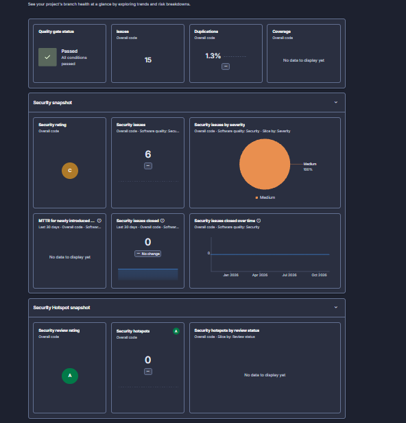

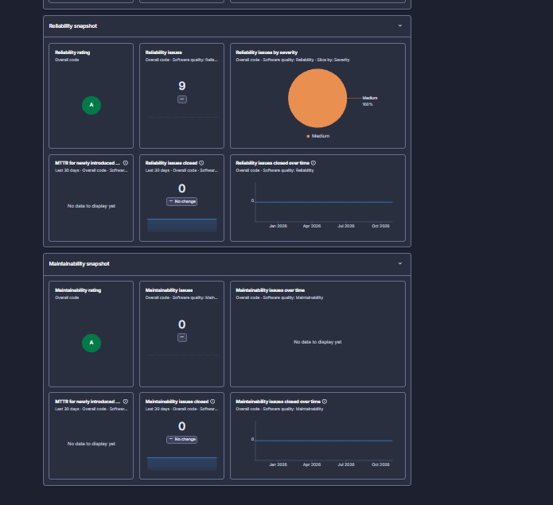

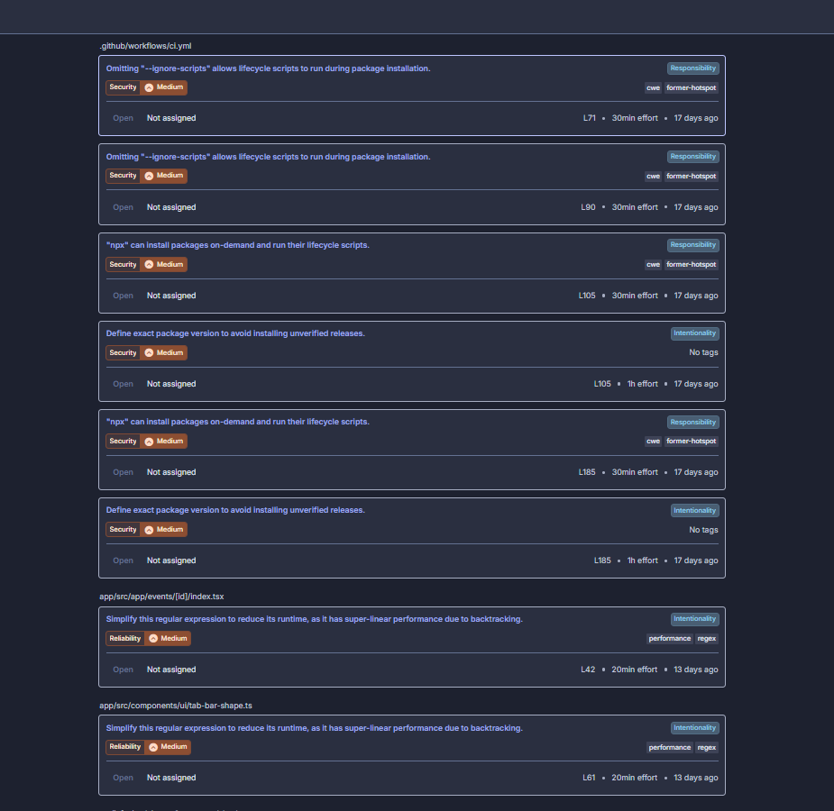

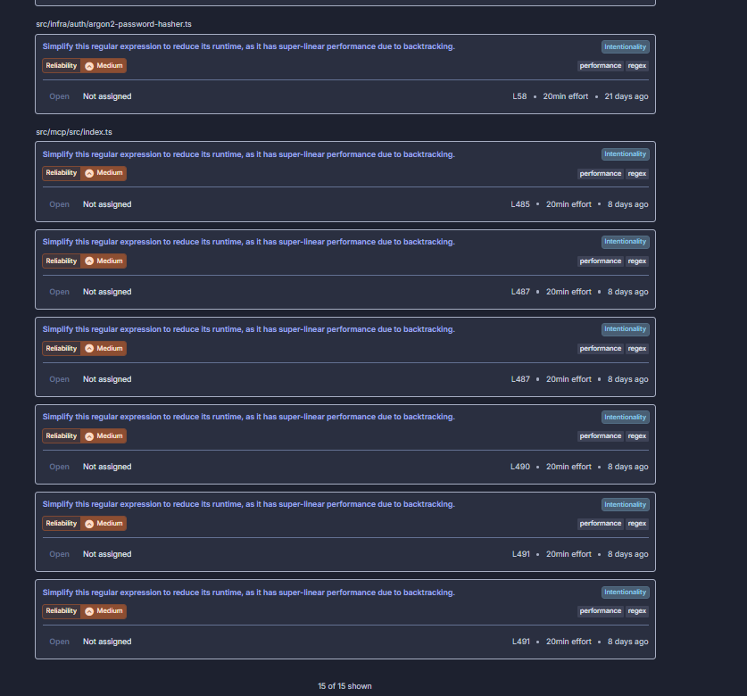

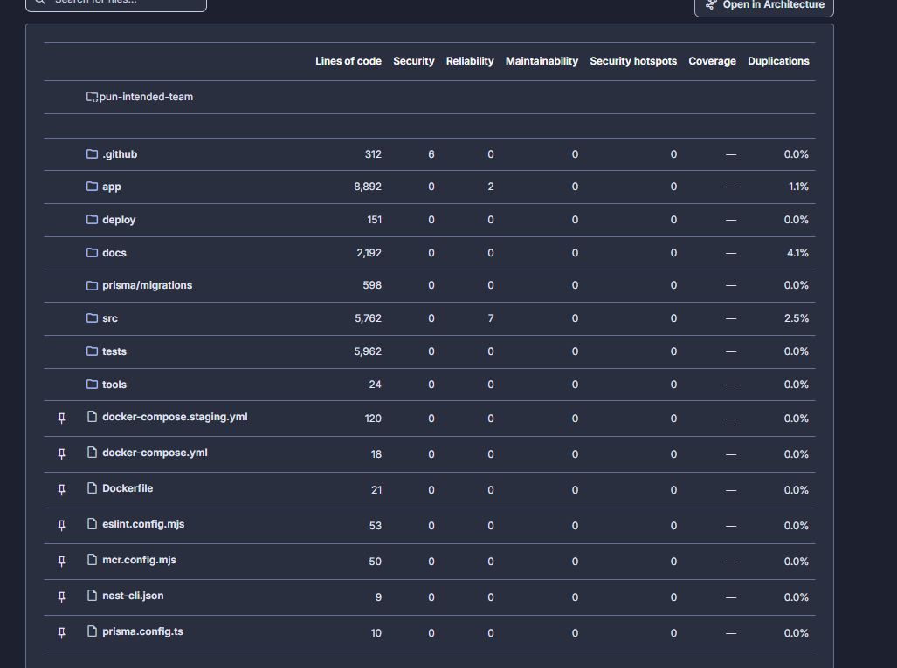

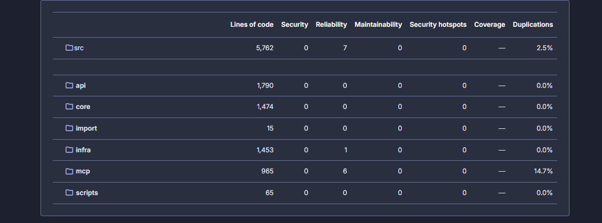

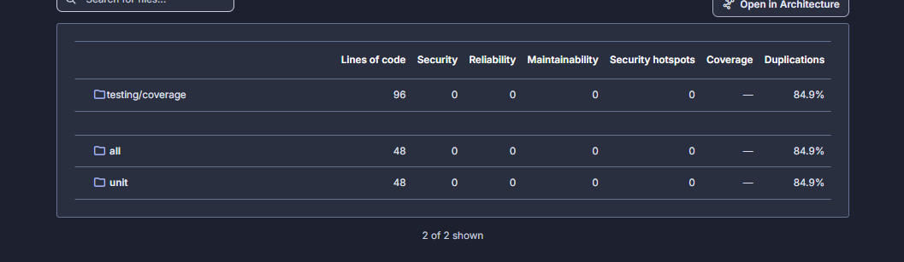

**After** (the analysis of `7886fde`, 2026-11-01, 5:01 PM):

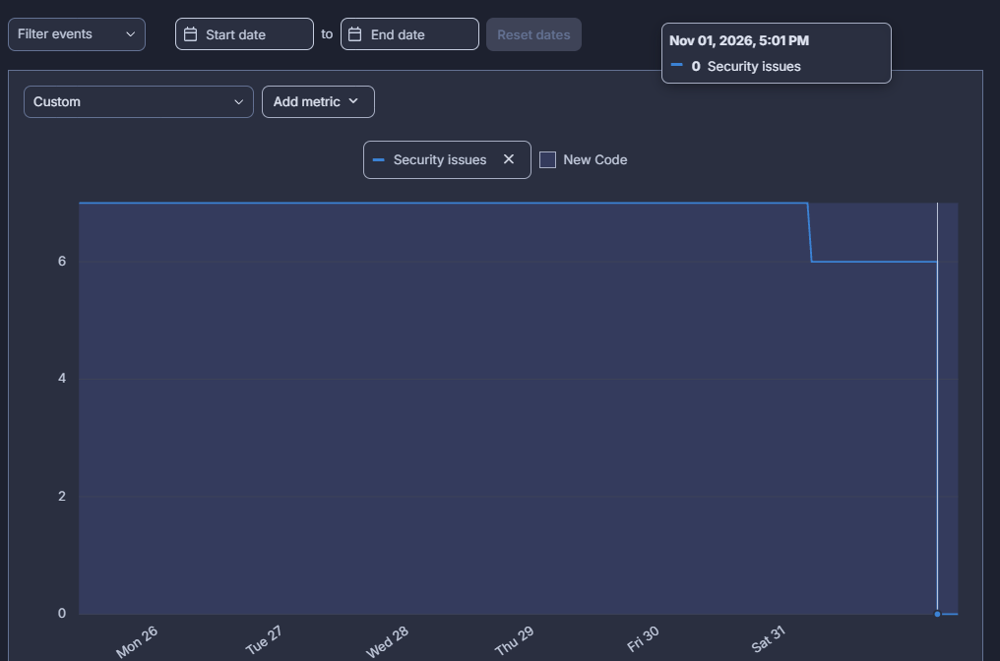

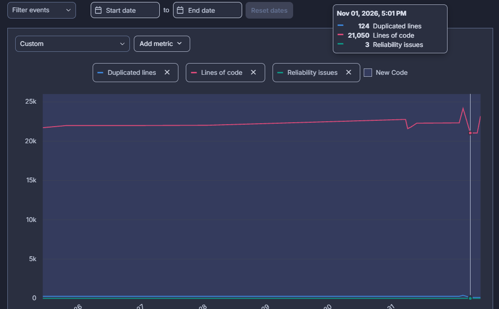

**Later analysis** (`26f0127`, 23,157 lines of code). These two include the later merges, so their numbers are not the "after" values; they show that `src/mcp/` and `docs/testing/coverage/` are gone from the analysis:

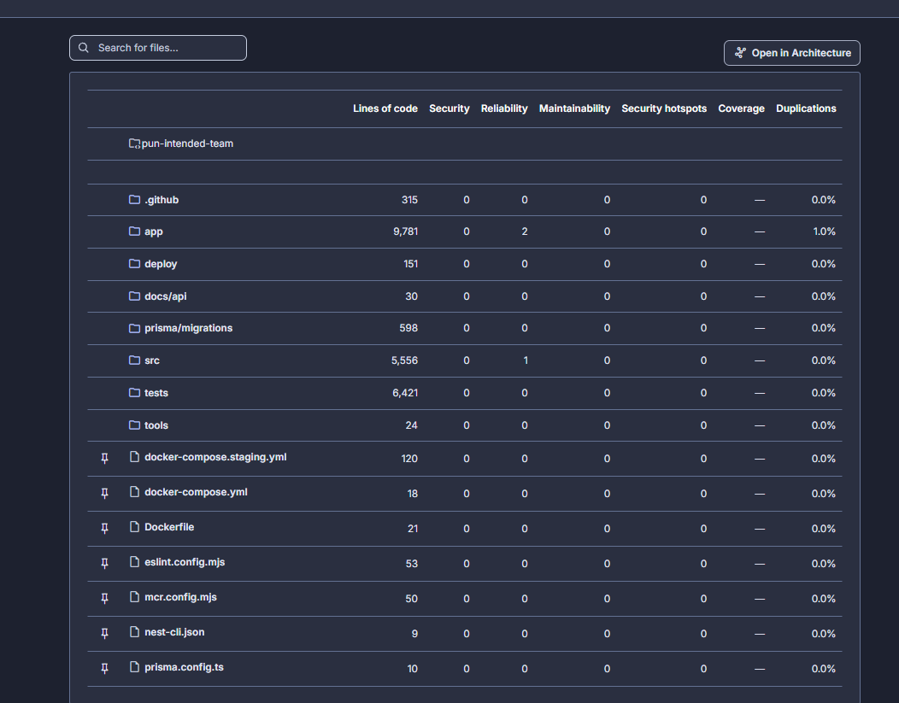

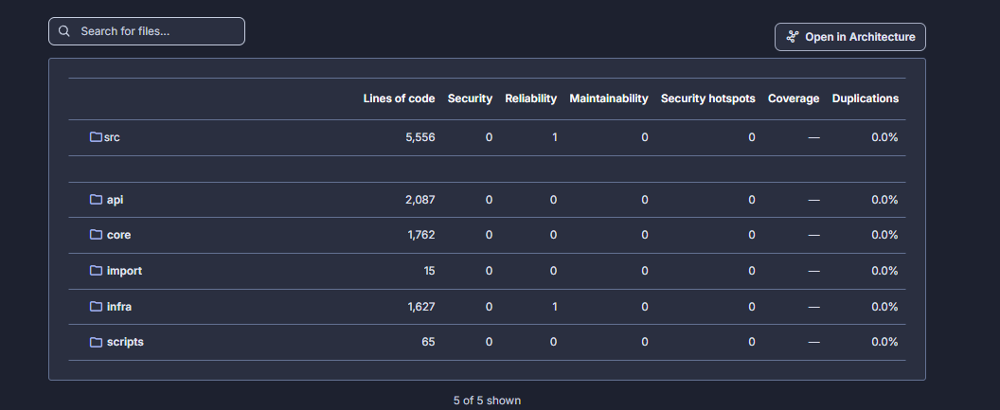

## Regression Testing

The unit and e2e tests were run before and after the refactorings: on `feature/293-pre-refactor` (commit `eaaba80`) and on `main` after PRs #295, #296 and #297 (commit `bf84a4a`).

| Suite | Before (`feature/293-pre-refactor`) | After (`main`) |
|---|---|---|
| Unit (`npm run test:unit`) | 343 run, 343 passed, 0 failed | 345 run, 345 passed, 0 failed |
| E2E (`npm run test:e2e`) | 173 run, 173 passed, 0 failed | 173 run, 173 passed, 0 failed |
| CI | [run 40282299762](https://github.com/ukma-fin-ssdm-2026/pun-intended-team/actions/runs/40282299762) ✅ | [run 40667353219](https://github.com/ukma-fin-ssdm-2026/pun-intended-team/actions/runs/40667353219) ✅ |

**Result.** No regressions: every test that passed before passes after. The two extra unit tests were added in #297 together with the change to Google linking, in [tests/unit/auth.service.test.ts](../../tests/unit/auth.service.test.ts): *refuses a Google account another account linked at the same time* and *refuses a second Google account linked at the same time*. The only other test change is an import of `ageOn` from its new module in `profiles.service.test.ts`.

## Bonuses

### Quality Gate as a Required Check

`SonarCloud Code Analysis` is a required status check in the `main` ruleset, next to `CI passed`, so a pull request whose Quality Gate fails cannot be merged (#347). Before, only `CI passed` was required: a red Quality Gate showed in the pull request but did not block the merge.

Demo in [#349](https://github.com/ukma-fin-ssdm-2026/pun-intended-team/pull/349):

| Commit | Change | Quality Gate |
|---|---|---|
| `1d35705` | Compares a date with itself (`typescript:S1764`, a bug) | ❌ [Failed](https://github.com/ukma-fin-ssdm-2026/pun-intended-team/runs/124932158826): Reliability C and Maintainability B on new code; merging blocked |
| `6d2b541` | Removes the bug | ✅ [Passed](https://github.com/ukma-fin-ssdm-2026/pun-intended-team/runs/124934031520) |

## AI Usage Note

The metrics were retrieved and this report was drafted with Claude Code; the team reviewed the findings against the SonarCloud dashboard and the code. The Regression Testing section was drafted with Claude Code from test runs that were performed and checked by hand (Daryna Halytska).

The Chosen Metrics and Security Rating sections were drafted with Claude Code from the SonarCloud Web API and the team's dashboard screenshots. Reviewed by Vlad-Re
